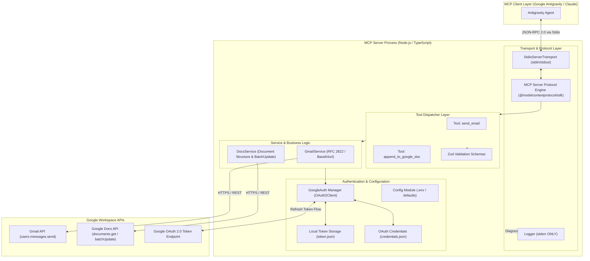
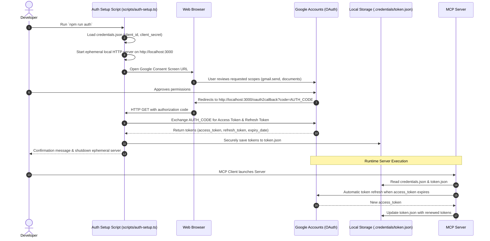

# Architecture Design: Google Workspace MCP Server (Gmail & Google Docs)

## 1. Executive Summary

This document specifies the technical architecture for the **Google Workspace MCP Server**, a Model Context Protocol (MCP) server that enables AI clients (such as Google Antigravity, Claude Desktop, and Cursor) to interact securely with Google Workspace.

The server exposes two primary tools:
1. `send_email`: Send plain-text emails via the user's Gmail account using the Gmail API.
2. `append_to_google_doc`: Append plain-text content to the end of an existing Google Doc using the Google Docs API.

The server is built with **Node.js** and **TypeScript**, utilizing the official `@modelcontextprotocol/sdk`, Google's official `googleapis` / `google-auth-library`, and `zod` for rigorous schema validation. It operates over the standard `stdio` transport, maintaining strict protocol cleanliness while isolating credentials through OAuth 2.0 with the principle of least privilege.

---

## 2. High-Level Architecture

The system operates as a local subprocess spawned by an MCP-compatible client. The client communicates with the server via standard I/O (JSON-RPC 2.0 over `stdin`/`stdout`). The server authenticates against Google APIs using user-delegated OAuth 2.0 access tokens.



---

## 3. Key Design Principles & Architectural Decisions

### 3.1. Stdio Transport Protocol Integrity
The Model Context Protocol relies on uncorrupted JSON-RPC messages transmitted via standard output (`stdout`). 
- **Rule:** `console.log` is strictly banned in application code.
- **Implementation:** A dedicated `Logger` utility writes all diagnostics, startup notices, and error traces exclusively to `process.stderr`.

### 3.2. Principle of Least Privilege
OAuth 2.0 scopes are strictly constrained to the minimum capabilities required by the problem statement:
- **Gmail Scope:** `https://www.googleapis.com/auth/gmail.send` (send-only; does not grant permission to read, search, delete, or list user emails).
- **Google Docs Scope:** `https://www.googleapis.com/auth/documents` (create/edit documents; does not grant broad Google Drive delete or global drive access).

### 3.3. Layered Separation of Concerns
1. **Entry & Protocol Layer (`src/index.ts`)**: Initializes the MCP server, defines capabilities, and routes `tools/list` and `tools/call` requests.
2. **Tool Definition Layer (`src/tools/*`)**: Maps MCP schemas to Zod contracts and transforms internal service results into standard MCP `CallToolResult` JSON payloads.
3. **Service Layer (`src/services/*`)**: Implements pure Google Workspace API logic, independent of the MCP protocol. Handles payload construction, byte indexing, and error normalization.
4. **Auth & Config Layer (`src/auth/*`, `src/config/*`)**: Encapsulates OAuth2 credentials loading, automatic token refresh callbacks, and token file persistence.

---

## 4. Component Design

### 4.1. Directory Structure

```text
d:/MCP Server/
├── docs/
│   └── problemStatement.md     # Original requirements document
├── src/
│   ├── index.ts                # Server entry point & tool registration
│   ├── config/
│   │   └── index.ts            # Environment variables and configuration defaults
│   ├── auth/
│   │   └── googleAuth.ts       # OAuth2 client factory and token manager
│   ├── services/
│   │   ├── gmailService.ts     # RFC 2822 builder and Gmail API caller
│   │   └── docsService.ts      # Docs structure parser and batchUpdate caller
│   ├── tools/
│   │   ├── sendEmail.ts        # send_email tool definition & handler
│   │   └── appendToDoc.ts      # append_to_google_doc tool definition & handler
│   └── utils/
│       └── logger.ts           # Stderr-safe logger
├── scripts/
│   └── auth-setup.ts           # Interactive OAuth setup & token generation CLI
├── tests/
│   ├── mocks/
│   │   └── googleMocks.ts      # Google API mock fixtures
│   ├── sendEmail.test.ts       # send_email validation & dispatch tests
│   ├── appendToDoc.test.ts     # append_to_google_doc validation & dispatch tests
│   ├── gmailService.test.ts    # Gmail service unit tests
│   └── docsService.test.ts     # Docs service unit tests
├── .env.example                # Sample environment variables
├── .gitignore                  # Git ignore protecting secrets and build output
├── tsconfig.json               # TypeScript compiler options
├── package.json                # Dependencies, scripts, and package metadata
├── architecture.md             # This document
└── README.md                   # Complete installation, setup, and usage guide
```

---

## 5. Tool Specifications & Data Contracts

### 5.1. Tool 1: `send_email`

#### Description
Sends a plain-text email from the authenticated user's Gmail account.

#### Input Schema (JSON Schema / Zod)
```json
{
  "type": "object",
  "properties": {
    "to": {
      "type": "string",
      "description": "Recipient email address (e.g. user@example.com)"
    },
    "subject": {
      "type": "string",
      "description": "Email subject line (must not be empty)"
    },
    "body": {
      "type": "string",
      "description": "Plain-text email body content"
    },
    "cc": {
      "type": "string",
      "description": "Optional CC recipient email address(es)"
    }
  },
  "required": ["to", "subject", "body"]
}
```

#### Message Encoding Flow
1. Format headers according to RFC 2822:
   ```text
   From: me
   To: <to>
   Cc: <cc> (if present)
   Subject: =?utf-8?B?...?= (RFC 2047 encoded if non-ASCII) or raw UTF-8
   Content-Type: text/plain; charset=utf-8
   MIME-Version: 1.0

   <body>
   ```
2. Convert the entire message string to UTF-8 bytes and encode as URL-safe base64 (`base64url` without standard padding issues).
3. Transmit payload to `gmail.users.messages.send({ userId: 'me', requestBody: { raw } })`.

#### Expected Output
```json
{
  "content": [
    {
      "type": "text",
      "text": "{\n  \"success\": true,\n  \"message\": \"Email sent successfully.\",\n  \"messageId\": \"18c4b9f2e3a1d07c\"\n}"
    }
  ]
}
```

---

### 5.2. Tool 2: `append_to_google_doc`

#### Description
Appends plain-text content to the end of an existing Google Doc without modifying existing content.

#### Input Schema (JSON Schema / Zod)
```json
{
  "type": "object",
  "properties": {
    "documentId": {
      "type": "string",
      "description": "The Google Doc ID extracted from the document URL"
    },
    "content": {
      "type": "string",
      "description": "Text content to append to the end of the document"
    }
  },
  "required": ["documentId", "content"]
}
```

#### Insertion Index Calculation & Behavior
In Google Docs API:
1. Call `docs.documents.get({ documentId })`.
2. Inspect `document.body.content`:
   - Google Docs represents document structure as a sequence of `StructuralElement` objects.
   - The document always ends with a newline segment. The final element contains an `endIndex`.
   - The valid insertion point at the end of the document body is `endIndex - 1`. Inserting at `endIndex` itself causes an `Invalid Index` error from the Google Docs API.
   - If the document is completely empty (aside from the terminal delimiter), `endIndex` is 2 and insertion point is 1.
3. Formulate the batch update request:
   ```json
   {
     "insertText": {
       "location": {
         "index": targetIndex
       },
       "text": contentToInsert
     }
   }
   ```
4. Transmit payload to `docs.documents.batchUpdate({ documentId, requestBody: { requests: [...] } })`.

#### Expected Output
```json
{
  "content": [
    {
      "type": "text",
      "text": "{\n  \"success\": true,\n  \"message\": \"Content appended to the Google Doc successfully.\",\n  \"documentId\": \"1a2b3c4d5e6f7g8h9i0j\"\n}"
    }
  ]
}
```

---

## 6. Authentication Architecture & Token Lifecycle

### 6.1. OAuth 2.0 Workflow
Because this is a locally run developer tool / desktop application, Google OAuth 2.0 for Desktop/Installed Applications is utilized.



### 6.2. Credentials & Token Security
- `credentials.json` (OAuth Client ID & Secret) and `token.json` (Access & Refresh tokens) must **never** be checked into version control.
- Both filenames, along with `.credentials/` directory and `.env`, are included in `.gitignore`.
- Fallback environment variables (`GOOGLE_CLIENT_ID`, `GOOGLE_CLIENT_SECRET`, `GOOGLE_REFRESH_TOKEN`) allow deployment in environments where local JSON credential files are injected via environment secrets.

---

## 7. Error Handling & Resilience Strategy

All tool calls wrap operations in structured error handling to ensure informative feedback is sent back to the MCP Client:

| Error Type | Trigger | System Response |
| :--- | :--- | :--- |
| **Validation Error** | Missing required fields, invalid email format, empty content | Returns `isError: true` with a clear explanation of which fields failed Zod schema validation. |
| **Authentication Error** | Missing `token.json` or uninitialized OAuth client | Returns `isError: true` directing the user to run `npm run auth` or verify credentials. |
| **Expired Token** | Access token expired | Automatically refreshed using refresh token via `google-auth-library`. |
| **Revoked / Invalid Token** | Refresh token invalidated | Returns clear error stating re-authentication is required. |
| **Document Not Found** | HTTP 404 from Google Docs API | Returns `isError: true` with message: "Google Doc with ID '<id>' was not found. Please verify the document ID and sharing permissions." |
| **Permission Denied** | HTTP 403 from Google API | Returns `isError: true` detailing whether user lacks edit access to the Doc or has not authorized the required scope. |

---

## 8. Client Integration (Antigravity & Claude)

### 8.1. Google Antigravity Integration
In Google Antigravity, MCP servers are declared in `mcp_config.json`:
- **Global location**: `~/.gemini/config/mcp_config.json`
- **Workspace location**: `.agents/mcp_config.json` or plugin `mcp_config.json`

Configuration snippet:
```json
{
  "mcpServers": {
    "google-workspace": {
      "command": "node",
      "args": ["d:/MCP Server/dist/index.js"],
      "env": {
        "NODE_ENV": "production"
      }
    }
  }
}
```

During development with TypeScript direct execution:
```json
{
  "mcpServers": {
    "google-workspace": {
      "command": "npx",
      "args": ["-y", "tsx", "d:/MCP Server/src/index.ts"]
    }
  }
}
```

### 8.2. Claude Desktop Integration
In `claude_desktop_config.json`:
```json
{
  "mcpServers": {
    "google-workspace": {
      "command": "node",
      "args": ["d:\\MCP Server\\dist\\index.js"]
    }
  }
}
```

---

## 9. Testing & Quality Assurance Plan

1. **Unit Tests (with Mocks)**:
   - Validate Zod schema constraints (empty body, malformed email, missing documentId).
   - Mock Google Docs API responses (`documents.get` returning arbitrary structural elements to test end-index calculation).
   - Mock Gmail API responses (`users.messages.send` returning message ID).
2. **Integration Verification**:
   - Verify MCP protocol handshake (`initialize`, `tools/list`, `tools/call`).
   - Interactive verification with Google's OAuth consent flow using `scripts/auth-setup.ts`.
3. **Automated Test Runner**:
   - Built on Node's native test runner (`node:test` + `node:assert`) executed via TypeScript, ensuring zero flaky dependencies and fast, reliable execution.
