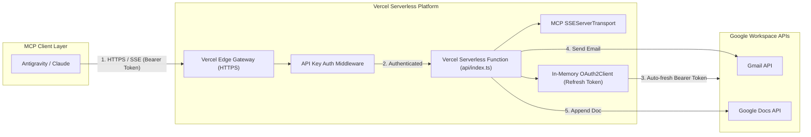

# Deployment Plan: Deploying Google Workspace MCP Server to Vercel

## 1. Executive Summary

This plan outlines the architecture, code adaptations, security hardening, and step-by-step deployment procedure to host the **Google Workspace MCP Server** on **Vercel**.

Deploying to Vercel shifts the MCP server from a **local, stdio-based subprocess** to a **globally accessible, serverless HTTP/SSE (Server-Sent Events) endpoint**. This allows AI clients (Google Antigravity, Claude Desktop, Cursor, or remote agents) to invoke Gmail and Google Docs actions without needing the server or Node.js runtime running locally on the user's machine.

---

## 2. Local vs. Vercel Architecture Comparison

| Architectural Aspect | Current Local Implementation | Vercel Serverless Implementation |
| :--- | :--- | :--- |
| **Transport** | `StdioServerTransport` (`stdin` / `stdout`) | `SSEServerTransport` over HTTP (GET `/sse`, POST `/message`) |
| **Process Lifecycle** | Long-running Node.js process | Ephemeral Serverless Functions triggered per request |
| **Credentials & Tokens** | Read/write from local `credentials.json` & `token.json` files | Immutable Vercel Environment Variables (`GOOGLE_REFRESH_TOKEN`) |
| **Access Control** | Restricted to local machine user | Protected via Bearer API Key authentication |
| **Networking** | IPC via standard I/O pipes | Public HTTPS with custom domain / `vercel.app` URL |



---

## 3. Core Technical Challenges & Solutions on Vercel

### Challenge 1: Read-Only Ephemeral Filesystem
- **Problem**: Vercel serverless functions cannot write persistent files like `token.json`. Files written to `/tmp` are destroyed when functions spin down.
- **Solution**: Inject the OAuth credentials directly into Vercel Project Environment Variables:
  - `GOOGLE_CLIENT_ID`
  - `GOOGLE_CLIENT_SECRET`
  - `GOOGLE_REFRESH_TOKEN` *(extracted from your existing working `token.json`)*
- `google-auth-library` will use the long-lived refresh token in memory to obtain fresh access tokens automatically upon every cold start.

### Challenge 2: Long-Lived Connections & Function Timeouts
- **Problem**: MCP SSE connections are typically long-lived HTTP streams, whereas Vercel Serverless functions have execution limits (15 seconds default on Hobby, up to 60–300 seconds on Pro).
- **Solution**: 
  1. Configure `maxDuration` in `vercel.json` to 60 seconds (or maximum allowed for your Vercel plan).
  2. Implement reconnection-tolerant SSE handling where MCP clients (like `mcp-remote` or Antigravity's SSE client) seamlessly reconnect on disconnects.

### Challenge 3: Public Endpoint Security
- **Problem**: Deploying to `https://<your-project>.vercel.app/sse` exposes your Gmail and Google Docs capabilities to the public internet.
- **Solution**: Enforce an authorization token header on all incoming requests (`Authorization: Bearer <MCP_API_SECRET>`). Reject any unauthenticated calls with HTTP 401.

---

## 4. Required Project Structure for Vercel

```text
d:/MCP Server/
├── api/
│   └── index.ts                # Vercel Serverless entrypoint (SSE & Message handler)
├── src/
│   ├── auth/
│   │   └── googleAuth.ts       # Enhanced to support in-memory refresh token
│   ├── config/
│   │   └── index.ts            # Added MCP_API_SECRET and GOOGLE_REFRESH_TOKEN
│   ├── services/
│   │   ├── gmailService.ts     # Unchanged
│   │   └── docsService.ts      # Unchanged
│   └── tools/
│       ├── sendEmail.ts        # Unchanged
│       └── appendToDoc.ts      # Unchanged
├── vercel.json                 # Vercel deployment and routing configuration
├── package.json                # Dependencies updated for express or web adapters
├── deployment-plan.md          # This document
└── architecture.md
```

---

## 5. Detailed Implementation Steps

### Phase 1: Environment & Auth Adaptation

#### 1.1 Update `src/config/index.ts`
Support environment-based refresh tokens and API secret keys:
```typescript
export interface AppConfig {
  credentialsPath: string;
  tokenPath: string;
  clientId?: string;
  clientSecret?: string;
  refreshToken?: string;        // Added for Vercel deployment
  mcpApiSecret?: string;        // Added for endpoint security
  redirectUri: string;
  authServerPort: number;
  scopes: string[];
}
```

#### 1.2 Update `src/auth/googleAuth.ts`
Enable `getAuthenticatedClient()` to construct an active OAuth client purely from environment variables when running in a serverless environment:
```typescript
if (config.refreshToken && config.clientId && config.clientSecret) {
  const client = new google.auth.OAuth2(config.clientId, config.clientSecret);
  client.setCredentials({
    refresh_token: config.refreshToken,
  });
  return client;
}
```

---

### Phase 2: Create the Vercel Serverless Entrypoint

Create `api/index.ts` using Express or native Node HTTP with `@modelcontextprotocol/sdk/server/sse.js`:

```typescript
import express from 'express';
import { Server } from '@modelcontextprotocol/sdk/server/index.js';
import { SSEServerTransport } from '@modelcontextprotocol/sdk/server/sse.js';
import { ListToolsRequestSchema, CallToolRequestSchema } from '@modelcontextprotocol/sdk/types.js';
import { sendEmailToolDefinition, executeSendEmail } from '../src/tools/sendEmail.js';
import { appendToDocToolDefinition, executeAppendToDoc } from '../src/tools/appendToDoc.js';
import { config } from '../src/config/index.js';

const app = express();
app.use(express.json());

// Security Middleware: Validate MCP_API_SECRET
app.use((req, res, next) => {
  if (config.mcpApiSecret) {
    const authHeader = req.headers.authorization;
    if (authHeader !== `Bearer ${config.mcpApiSecret}`) {
      return res.status(401).json({ error: 'Unauthorized: Invalid or missing API Key' });
    }
  }
  next();
});

let transport: SSEServerTransport | null = null;

const server = new Server(
  { name: 'google-workspace-mcp', version: '1.0.0' },
  { capabilities: { tools: {} } }
);

server.setRequestHandler(ListToolsRequestSchema, async () => ({
  tools: [sendEmailToolDefinition, appendToDocToolDefinition],
}));

server.setRequestHandler(CallToolRequestSchema, async (request) => {
  const { name, arguments: args } = request.params;
  if (name === 'send_email') return await executeSendEmail(args);
  if (name === 'append_to_google_doc') return await executeAppendToDoc(args);
  throw new Error(`Tool not found: ${name}`);
});

// GET /sse endpoint establishes the Server-Sent Events stream
app.get('/sse', async (req, res) => {
  transport = new SSEServerTransport('/message', res);
  await server.connect(transport);
});

// POST /message endpoint accepts client JSON-RPC invocations
app.post('/message', async (req, res) => {
  if (transport) {
    await transport.handlePostMessage(req, res);
  } else {
    res.status(400).send('SSE transport not initialized');
  }
});

export default app;
```

---

### Phase 3: Configure `vercel.json`

Create `vercel.json` in the root folder:

```json
{
  "version": 2,
  "builds": [
    {
      "src": "api/index.ts",
      "use": "@vercel/node"
    }
  ],
  "routes": [
    {
      "src": "/(.*)",
      "dest": "api/index.ts"
    }
  ]
}
```

---

## 6. Step-by-Step Deployment Procedure

### Step 1: Extract Existing Refresh Token
From your authorized `token.json` and `credentials.json` files:
- `refresh_token`: Copy from your local `token.json`
- `client_id`: Copy from your local `credentials.json`
- `client_secret`: Copy from your local `credentials.json`

### Step 2: Generate a Secure API Secret
Generate a random secret key for securing your Vercel MCP endpoint:
```powershell
# In PowerShell:
[Convert]::ToBase64String((1..32 | ForEach-Object { Get-Random -Maximum 256 }))
```
Example secret: `mcp_sec_8f92b7c40e1189d`

### Step 3: Deploy to Vercel via Vercel CLI

1. Install Vercel CLI:
   ```bash
   npm install -g vercel
   ```
2. Link & Deploy:
   ```bash
   vercel
   ```
3. Set Environment Variables in Vercel:
   ```bash
   vercel env add GOOGLE_CLIENT_ID production
   vercel env add GOOGLE_CLIENT_SECRET production
   vercel env add GOOGLE_REFRESH_TOKEN production
   vercel env add MCP_API_SECRET production
   ```
4. Deploy to production:
   ```bash
   vercel --prod
   ```

*(Alternatively, push your code to GitHub, connect the repository to Vercel via the web console at [https://vercel.com/dashboard](https://vercel.com/dashboard), and add the four environment variables in **Project Settings > Environment Variables**).*

---

## 7. Connecting MCP Clients to Your Vercel MCP Server

Once deployed, your server will be live at `https://<your-project>.vercel.app`.

### 1. In Google Antigravity

Update `~/.gemini/config/mcp_config.json` or `.agents/mcp_config.json`:

```json
{
  "mcpServers": {
    "google-workspace-remote": {
      "command": "npx",
      "args": [
        "-y",
        "mcp-remote",
        "https://<your-project>.vercel.app/sse?key=YOUR_MCP_API_SECRET"
      ]
    }
  }
}
```

*Note: Antigravity supports `mcp-remote` out of the box (as shown in your Alphavantage configuration).*

### 2. In Claude Desktop

In `%APPDATA%\Claude\claude_desktop_config.json`:

```json
{
  "mcpServers": {
    "google-workspace-remote": {
      "command": "npx",
      "args": [
        "-y",
        "mcp-remote",
        "https://<your-project>.vercel.app/sse?key=YOUR_MCP_API_SECRET"
      ]
    }
  }
}
```

---

## 8. Summary Checklist Before Launch

- [ ] `GOOGLE_REFRESH_TOKEN` copied to Vercel Environment Variables.
- [ ] `GOOGLE_CLIENT_ID` and `GOOGLE_CLIENT_SECRET` configured in Vercel.
- [ ] `MCP_API_SECRET` configured to prevent unauthorized public access.
- [ ] `api/index.ts` created with SSE and POST `/message` routes.
- [ ] `vercel.json` added to project root.
- [ ] Vercel deployment verified by testing GET `/sse` returns 200 stream with endpoint event.
- [ ] Client config tested in Google Antigravity via `mcp-remote`.
